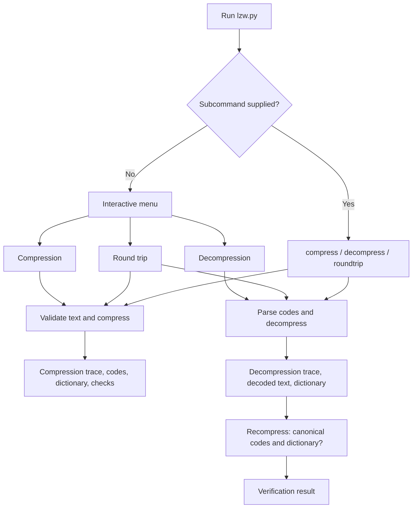

# LZW compression and decompression walkthrough

## 1. Overview

This program processes strings over `{a, b, c}`. The initial dictionary maps `a`, `b`, and `c` to codes `0`, `1`, and `2`; learned entries start at code `3`. The reusable functions in `lzw.py` perform compression, code parsing, and decompression without printing. `lzw_compress.py` preserves the original Project 2 command-line entry point.

## 2. Program flow

## 3. Compression, step by step

For each input character `k`, the compressor checks whether `w + k` is in the dictionary. If it is, `w` grows to that longer string. Otherwise, the compressor emits the code for `w`, adds `w + k` at the next free index, and starts a new `w` at `k`. At the end, it emits the code for the remaining `w`.

For `abababab`, the additions are `ab=3`, `ba=4`, `aba=5`, and `abab=6`. The emitted codes are `[0, 1, 3, 5, 1]`. Substituting the code entries and decoding the stream both recover the original text.

## 4. Decompression, step by step

The decoder receives only the codes. It initializes the inverse dictionary `{0: "a", 1: "b", 2: "c"}`, reads the first code to obtain `previous`, and handles each later code as follows:

1. If the code exists in the dictionary, its value is the current entry.
2. If it equals the next free index, use the special case described below.
3. Any other unavailable code is invalid.
4. Add `previous + entry[0]` at the next free index, then set `previous` to `entry`.

For `[0, 1, 3, 5, 1]`, the decoded entries are `a`, `b`, `ab`, `aba`, and `b`. The decoder rebuilds `ab=3`, `ba=4`, `aba=5`, and `abab=6`, producing `abababab`.

## 5. Why the special case exists

The compressor can emit the code of an entry it created one step earlier. At that point, the decoder has not added that entry yet. It can infer the missing value from the previous entry and the first character of that same value. This is the classic `cScSc` pattern.

When the current code equals the next free index, the missing entry must be `previous + previous[0]`. The compressor created this entry by extending the previous sequence with the first character of the sequence it is about to emit. In this boundary case, that next sequence begins with `previous`, so its first character is `previous[0]`.

For example, with `[0, 3, 4]`, the decoder first reads `a`. Code `3` is not in the dictionary yet, so the entry is `a + a = aa`. The next special code produces `aaa`. The decoded text is `aaaaaa`. A code greater than the next free index, such as `7` when the next index is `3`, is invalid.

## 6. Verification and menu

After decoding, the program recompresses the text. If both the codes and dictionary match, it prints `Verification OK`. A stream can be decodable but differ from this compressor's canonical output; that is reported as `Verification: non-canonical codes`, not as a decoding error.

Run `python3 lzw.py` without arguments to open the menu. It offers compression, decompression, round trip, and quit, and returns to the menu after a handled input error. The `compress`, `decompress`, and `roundtrip` subcommands are also available directly.

## 7. Tests

Run `python3 -m unittest -v`. The suite covers the original compression cases, parser formats, invalid codes, the special case, the CLI and menu, all strings over `{a, b, c}` of lengths 1–8, and long deterministic inputs.
