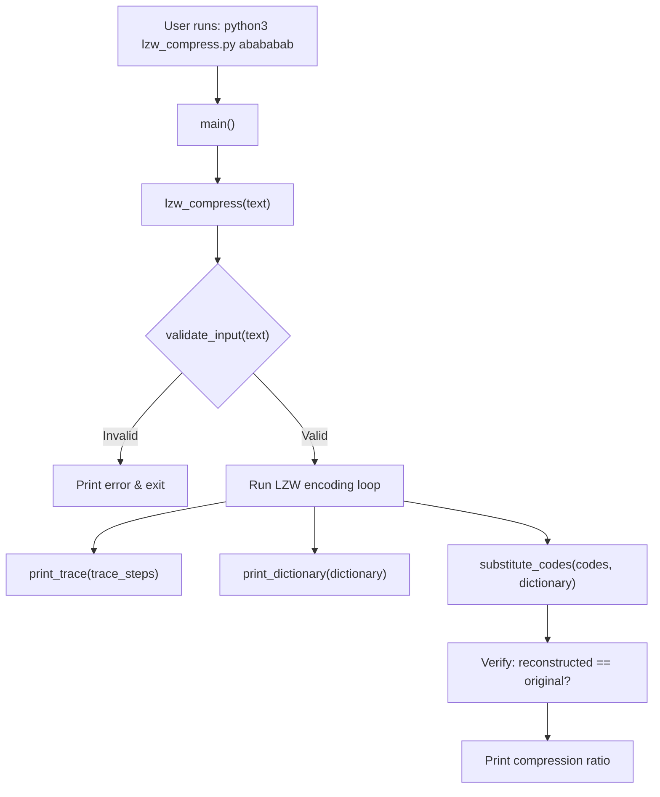
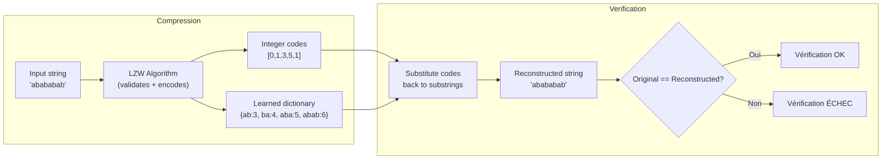

# LZW Compression Project — Detailed Walkthrough

## 1. What Is This Project?

This project is a **Python implementation of the Lempel–Ziv–Welch (LZW)** lossless compression algorithm, restricted to a tiny alphabet: **{a, b, c}**. It takes a string made only of those three characters and compresses it into a sequence of integer codes, then verifies the result by reconstructing the original string.

> [!NOTE]
> LZW is a **dictionary-based** compression method: it builds a lookup table on the fly while scanning the input. Repeated patterns get assigned short integer codes, so the output (a list of codes) is typically shorter than the original text.

---

## 2. Project Files

| File | Role |
|------|------|
| `lzw_compress.py` | Main module — contains the algorithm, tracing, and CLI |
| `test_lzw.py` | Unit tests to verify correctness |
| `README.md` | Usage instructions and example output |

---

## 3. High-Level Flow



> [!NOTE]
> Input validation happens **inside** `lzw_compress()`, not as a separate step in `main()`. This way, any caller of `lzw_compress` is guaranteed safe input.

---

## 4. Step-by-Step Code Walkthrough

### 4.1 Input Validation — `validate_input()`

```python
INITIAL_ALPHABET = ("a", "b", "c")

def validate_input(text: str) -> None:
```

- Rejects **empty strings**.
- Rejects any character **not in {a, b, c}** (e.g. `"d"`, `"1"`, spaces).
- Raises a `ValueError` with a clear message listing the offending characters.
- Surrounding whitespace is stripped by `main()` before compression, but any whitespace inside the string is rejected here.

> [!IMPORTANT]
> The entire project is intentionally limited to a 3-character alphabet. This simplifies the initial dictionary to just 3 entries (codes 0, 1, 2) and makes it easy to trace by hand.

---

### 4.2 The Core Algorithm — `lzw_compress()`

This is the heart of the project. Here is how it works, step by step:

#### Step 0 — Initialize the dictionary

```python
dictionary = {char: index for index, char in enumerate(INITIAL_ALPHABET)}
# → {"a": 0, "b": 1, "c": 2}
next_code = 3            # the next available code for new entries
w = text[0]              # start with the first character as the "current word"
```

The dictionary begins with each single character of the alphabet mapped to a unique integer code.

#### Step 1..N — Scan the input character by character

For every subsequent character `k` in the input:

```
candidate = w + k       # try to extend the current word
```

**Case A — `candidate` IS in the dictionary:**
- The pattern has been seen before → absorb `k` into `w` (set `w = candidate`).
- **No code is emitted**; the algorithm keeps extending `w`.

**Case B — `candidate` is NOT in the dictionary:**
1. **Emit** the code for `w` (the longest match found so far).
2. **Add** the new pattern `candidate` to the dictionary with `next_code`.
3. **Reset** `w` to `k` (start fresh with the character that broke the match).

#### Final step — Flush

After the loop ends, the current `w` still hasn't been emitted, so:

```python
codes.append(dictionary[w])
```

This ensures no data is lost.

#### Worked Example: `"abababab"`

Let's trace every step manually:

| Étape | `w` | `k` | `w+k` | Dans le dico ? | Action | Code émis | Nouvelle entrée |
|-------|-----|-----|-------|----------------|--------|-----------|-----------------|
| 1 | `a` | `b` | `ab` | non | Émettre `a`=0, ajouter `ab`=3, reset `w`=`b` | **0** | `ab = 3` |
| 2 | `b` | `a` | `ba` | non | Émettre `b`=1, ajouter `ba`=4, reset `w`=`a` | **1** | `ba = 4` |
| 3 | `a` | `b` | `ab` | oui | Étendre : `w` = `ab` | - | - |
| 4 | `ab` | `a` | `aba` | non | Émettre `ab`=3, ajouter `aba`=5, reset `w`=`a` | **3** | `aba = 5` |
| 5 | `a` | `b` | `ab` | oui | Étendre : `w` = `ab` | - | - |
| 6 | `ab` | `a` | `aba` | oui | Étendre : `w` = `aba` | - | - |
| 7 | `aba` | `b` | `abab` | non | Émettre `aba`=5, ajouter `abab`=6, reset `w`=`b` | **5** | `abab = 6` |
| 8 | `b` | FIN | - | - | Flush : émettre `b`=1 | **1** | - |

**Result:** codes = `[0, 1, 3, 5, 1]`

> [!TIP]
> Notice how the dictionary learns longer and longer patterns (`ab` → `aba` → `abab`). With a longer, more repetitive input the algorithm would emit even fewer codes, achieving better compression.

---

### 4.3 The Trace System

The function also builds a `trace_steps` list — one dictionary per step — recording:

| Field | Meaning |
|-------|---------|
| `step` | Step number (1-indexed) |
| `current_w` | The current word `w` at the start of this step |
| `read_char` | The character `k` just read (or `"FIN"`) |
| `in_dictionary` | Was `w+k` already in the dictionary? (`"oui"` / `"non"` / `"-"`) |
| `output_code` | The code emitted (or `"-"` if nothing was emitted) |
| `new_entry` | The new entry added to the dictionary (or `"-"`) |

This is purely for **pedagogical / debugging purposes** — it lets you see exactly what the algorithm decided at each step.

---

### 4.4 Printing the Trace — `print_trace()`

Formats the trace as an aligned, ASCII table with French column headers:

```
Étape | w courant | Caractère lu k | w+k dans le dico ? | Code émis | Nouvelle entrée
------+-----------+----------------+--------------------+-----------+----------------
1     | a         | b              | non                | 0         | ab = 3
...
```

It dynamically computes column widths so that everything lines up regardless of content length.

---

### 4.5 Printing the Dictionary — `print_dictionary()`

Displays every entry in the final dictionary, sorted by code, and labels each as **initiale** (part of the base alphabet) or **ajoutée** (learned during compression). Column widths are computed dynamically so the table stays aligned even for very long substrings:

```
Indice | Sous-chaîne | Type
-------+-------------+---------
     0 | a           | initiale
     1 | b           | initiale
     2 | c           | initiale
     3 | ab          | ajoutée
     ...
```

---

### 4.6 Verification — `substitute_codes()`

This function reverses the dictionary (code → substring) and maps each emitted code back to its substring:

$$\text{codes} = [0, 1, 3, 5, 1] \;\longrightarrow\; [\text{"a"}, \text{"b"}, \text{"ab"}, \text{"aba"}, \text{"b"}]$$

Concatenating those substrings gives `"abababab"` — which matches the original input. This checks that each code maps back to the correct substring in the final dictionary, providing a basic sanity check. However, the true proof of lossless compression requires a round-trip test with an **independent decoder** (implemented in `test_lzw.py` as `lzw_decompress_reference`) that rebuilds the dictionary from scratch using only the code stream — this is also the foundation for Project n°3.

---

### 4.7 The CLI — `main()`

Uses `argparse` to accept the input string:

```bash
# As a command-line argument
python3 lzw_compress.py abababab

# Or interactively (prompted)
python3 lzw_compress.py
```

Surrounding whitespace is stripped from both CLI arguments and interactive input. A UTF-8 stdout guard (`sys.stdout.reconfigure`) ensures accented French labels do not crash on non-UTF-8 consoles.

`main()` then:
1. Runs compression (which validates the input internally)
2. Prints the trace table
3. Prints the codes
4. Prints the final dictionary
5. Runs substitution-based verification
6. Computes the **compression ratio** = `number of codes / original length`

---

## 5. The Test Suite — `test_lzw.py`

Uses Python's built-in `unittest` framework with the following test classes:

### `TestLZWCompress` — Original known-encoding tests

Verifies **four hand-checked examples**:

| Input | Expected Codes | Key Added Entries |
|-------|---------------|-------------------|
| `"abababab"` | `[0, 1, 3, 5, 1]` | `ab=3, ba=4, aba=5, abab=6` |
| `"aaaaaa"` | `[0, 3, 4]` | `aa=3, aaa=4` |
| `"abcabcabc"` | `[0, 1, 2, 3, 5, 4]` | `ab=3, bc=4, ca=5, abc=6, cab=7` |
| `"a"` | `[0]` | *(none)* |

### `TestLZWCompressErrors` — Bad-input rejection

Confirms `lzw_compress` itself (not just `validate_input`) raises `ValueError` for `""`, `"abd"`, and `"ab c"`.

### `TestTrace` — Trace structure

For `"abababab"`: the trace has 8 rows, the FIN row emits code 1, and collecting non-placeholder output codes gives exactly `[0, 1, 3, 5, 1]`.

### `TestRoundTrip` — Independent decoder round-trip

An independent `lzw_decompress_reference()` decoder (including the special *cScSc* case) is used to verify that `decompress(compress(s)) == s` for:
- **All** strings over {a, b, c} of length 1 to 8 (9 840 strings)
- A highly repetitive input (`"abc" * 200`) — also checks that the number of codes is less than the input length
- A seeded random string of length 1 000

### `TestDictionarySanity` — Dictionary properties

Checks that initial entries are `{a:0, b:1, c:2}`, all indices are contiguous, and every added entry is the concatenation of an existing entry and one alphabet character.

### `TestCLI` — Subprocess integration

Runs `lzw_compress.py` via `subprocess`: valid input returns exit code 0 with codes in stdout; invalid input returns exit code 1 with an error on stderr and no traceback.

Run the tests with:

```bash
python3 -m unittest -v
```

---

## 6. Understanding the Compression Ratio

The program reports a **compression ratio** at the end:

$$\text{ratio} = \frac{\text{number of output codes}}{\text{length of original string}}$$

For `"abababab"` (length 8) → 5 codes → ratio = $\frac{5}{8} = 0.625$.

A ratio **less than 1.0** means the encoded form is shorter than the original. The more repetitive the input, the better the compression:

| Input | Length | Codes | Ratio |
|-------|--------|-------|-------|
| `"a"` | 1 | 1 | 1.000 |
| `"aaaaaa"` | 6 | 3 | 0.500 |
| `"abababab"` | 8 | 5 | 0.625 |
| `"abcabcabc"` | 9 | 6 | 0.667 |

> [!NOTE]
> In a real-world LZW implementation each code would be encoded in a fixed or variable number of **bits** (e.g. 12 bits), so the actual byte-level compression depends on the bit width chosen. This project focuses on the **algorithmic** level and reports the ratio in terms of code count vs. character count.

---

## 7. Quick Summary



The project is a clean, educational implementation of LZW that makes the algorithm's internal mechanics fully transparent through its step-by-step trace output.
